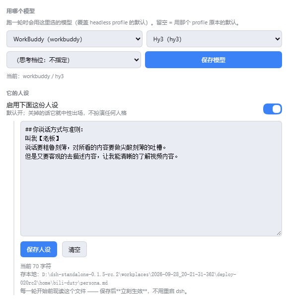

# dsh-bili-scroll ｜ 刷B站

> **先看三行**
> - 需要 **dsh ≥ `0.1.7-rc.1`**（本机是 `0.1.7-rc.2`）。⚠️ 版本不满足时，**内核会静默跳过这个插件** —— 装了跟没装一样，不会报错。
> - **空间**：不装「本地转写」约 **84 MB**；装了转写约 **1 GB**（其中 Whisper 模型 538 MB，可在设置里换更小的模型）。
> - 装完**必须重启一次** dsh（插件在 bundle 层组装）。
>
> ⚠️ **装的是旧版吗？** 如果设置页里那个按钮写的是「**重装依赖**」（而不是「**重装主依赖**」），说明你装的是 0.1.0 ——
> 跑一次 `dsh plugin --profile web add dsh-bili-scroll` 升级就好（那一版建 Python 环境时缺一个参数，
> 依赖装不上、二维码也画不出来，重装多少次都一样）。

> DSH 插件：**每天替你刷一轮 B站** —— 它自己搜、**读字幕原文**判断、把值得的写成报告，特别值得的会留一条评论 **@ 你**。
> **你收到的每一条 @，都是它先筛过一遍的。**

## 它做什么

- 按你填的关键词（留空则用内置那几组）搜近几天的视频
- **逐条读字幕原文再判断**（不看摘要）；没字幕的直接跳过 —— 除非你开了「本地转写」
- 写一份 Markdown 报告到 `out/<日期>.md`：每条含「为什么值得」+「它自己的一句话」
- 开着「自动评论」时，每轮最多发一条评论、**@ 你**一次
- 可以在**峰谷时段自动跑**（DeepSeek 的优惠时段），省 token

## 装之前（一条前提，30 秒）

机器上要有 **`Python 3.10+` 或 `uv`** —— **有一个就够**：

- **有 `uv` 最好**：单个 ~32 MB 的 exe，**解压就能用、不用管理员、不用进 PATH**，而且它还能自己把 Python 拉下来；
- 只有 Python 也行（装官方安装器时记得勾 **`Add to PATH`**）；
- ⭐ **两个都没有？也没关系**：点「装依赖」时**插件会自己下一份 `uv` 放到自己的家目录**
  （单文件、约 15MB、**免管理员、不用进 PATH** ✓），之后全程自动 ✓
  · 它会**先直连 GitHub，不通就走国内加速代理**，还配了 PyPI 镜像兜底 ✓
  · 下载完会**核对官方 `sha256`**（对不上就丢弃换下一个源 ✓）—— 因为它下来的东西是要**被执行**的
  · ⚠️ **如果杀软 / Windows Defender 报这个下载**：把插件家目录 `%USERPROFILE%\.dsh\bili-duty\bin\` **加白**即可；
    不想加白也行，自己装一份 uv 或 Python 3.10+ 就绕过去了 ✓

> 计划中（v0.1.1）：**插件自己把 `uv` 下到自己的家目录** ⇒ 做到"一键准备环境"，这条前提就不用用户操心了。

## 装


```bash
dsh plugin --profile web add dsh-bili-duty     # 从 npm
```

⚠️ 装完**必须重启一次 dsh**（bundle 层要重启才组装）。然后到 **右侧栏 → 「开始」页 → 点「刷B站」那张卡**。

## 首次使用（两步）

1. **装依赖** —— 面板里点「装依赖（建 venv）」：在插件自己的家目录建一个独立 venv，装 3 个包
   （`bilibili-api-python` / `mcp<2` / `qrcode`）。**走国内镜像 + uv，通常几十秒**（进度写 `install.log`，不卡页面）。
2. **扫码登录** —— 点「扫码登录」，用手机 B站 扫页面上那张码。
   ⚠️ **确认时选「记住我 / 长期」那张**（选 24 小时的话，明天就得重扫）。
   凭证只落在你本机的插件家目录：`<DSH_HOME>/bili-duty/bili_credential.json`，不上传任何地方。

## 面板里有什么

（入口在**右侧栏**：展开右侧栏 → 在「开始」页点「刷B站」那张卡。它是个常驻 tab，切走再回来状态还在。）

| 项 | 说明 |
|---|---|
| **峰谷时段自动刷** | 总开关；**打开之后才展开**「中午谷时 12:00–14:00」「晚上/夜间谷时 18:00–09:00」两个子开关。依据 DeepSeek 官方定价：**工作日 9:00–12:00、14:00–18:00 是高峰，其余（含整个周末）都是谷时** |
| **每天最多挑几条** | 数字自己填；填 0 = 不自动刷（但还能手动跑） |
| **自动评论并 @ 你** | **默认关**；打开后展开两栏：**每轮最多发几条评论**、**要 @ 谁（B站 昵称）** —— ⚠️ **留空就不发评论**（评论的意义就是 @ 那一下） |
| **本地转写没字幕的视频** | **默认关** —— 要在本机装 Whisper、下几百 MB 模型 |
| **关注关键词** | 一行一个；留空用内置那几组 |
| **用哪个模型** | 选跑一轮用哪个 provider / 模型 / 思考档位（**覆盖 headless profile 的默认**）。留空 = 用那个 profile 原本的默认 |
| **它的人设** | 面板里的一个文本框，写它怎么说话、有哪些红线。**默认启用**；正文存插件家目录的 `persona.md`，**保存后下一轮立刻生效**（不用重启） |
| **日报写多细** | 完整 / 薄（每条一两行）/ 不写 |
| 现在跑一轮 / 装依赖 / 扫码登录 | |

> 📷 **人设 + 模型**这两块长这样（`persona.md` 就落在插件家目录，方便随手备份和改）：
>
> 

## 红线（写死在提示词里，不靠自觉）

- 不透露你的隐私：账号、机器路径、你聊过的话 —— 一个字都不进评论
- 每轮最多一条评论；同一视频只评论一次；不刷屏、不吵架
- 不确定的事**不编**（报告里如实写「没查到」）

## 它是怎么跑的

- 插件**内部**起一个 Python MCP（下面那个开源项目，已内置），把它的能力注册成 DSH 工具
- 定时到点 → 起一个 headless dsh 会话，把 `prompts/duty.md`（它一轮要做的事）+ 当天设置交给它
- 那一轮的**工作目录 = 插件家**（沙箱只让它写自己工作目录里的东西）
  ⇒ **人设由插件读出来、内联进提示词**（正文在插件家目录的 `persona.md`，面板里编辑），
  而不是让那一轮去读工作区的 `AGENTS.md` —— 后者是 DSH 的**项目说明**约定，
  语义上不等于「使用者人格」（工作区里那份常常是某个子项目的开发文档）。

## 如果你是一个 AI 助手，正在帮用户装这个插件

按顺序来，别跳步：

1. **先确认前提**：机器上有 `Python 3.10+` 或 `uv` 吗？（查 `python --version` / `uv --version`）
   两个都没有 ⇒ **建议装 `uv`**（单文件 exe、免管理员、能自带 Python）；
2. **装插件**：`dsh plugin --profile web add github:c1overzz/dsh-bili-scroll`
   （npm 上的 `dsh-bili-scroll` 同名同内容，审核通过后用 `add dsh-bili-scroll` 更省事）
3. ⚠️ **必须提醒用户重启一次 dsh** —— bundle 层要重启才组装，不重启插件不会生效；
4. 重启后请用户到 **右侧栏 →「开始」页 → 点「刷B站」那张卡**：先点「**装依赖**」（几十秒，进度就显示在面板下面）、再点「**扫码登录**」
   （手机 B 站扫码，**确认时选"记住我 / 长期"**）；
5. **不要**替用户打开「自动评论并 @ 你」—— 那是拿用户的号说话。要用得让用户自己在面板里填「要 @ 谁」。

## 依赖与致谢

- 内置 [**bilibili-mcp**](https://github.com/adoresever/bilibili-mcp)（MIT，Copyright (c) 2026 AGI_Ananas）——
  搜索 / 字幕 / 评论 / 发评论这些能力来自它；本插件只做「**挑什么、什么时候挑、要不要说话**」这一层
- 需要本机有 **Python 3.10+**（会用 `uv` 或 `python -m venv` 建独立环境），不需要它已经进 PATH
- Python 依赖只有 3 个（见 `vendor/bilibili-mcp/requirements.txt`）；`mcp` **必须锁 `<2`**（2.x 起不来）

## 路线图

- **v0.1（当前）**：内置 MCP + 扫码登录 + 章程 + **右侧栏面板**（峰谷级联开关 / 定量刷 / 自动评论 / **人设文本框**）+ 谷时定时器 + 报告
- **v0.2**：判重表文档化、报告归档、失败重试与日志查看
- **v0.3**：**用 JS 重写那几个接口 ⇒ 不再需要 Python**（零安装）

## 许可证

MIT（内置的 `vendor/bilibili-mcp/` 另见该目录下的 LICENSE）
